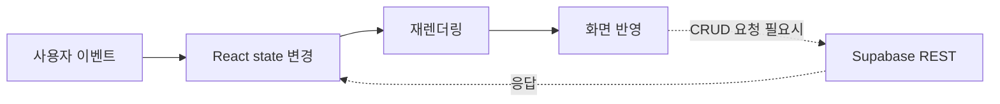
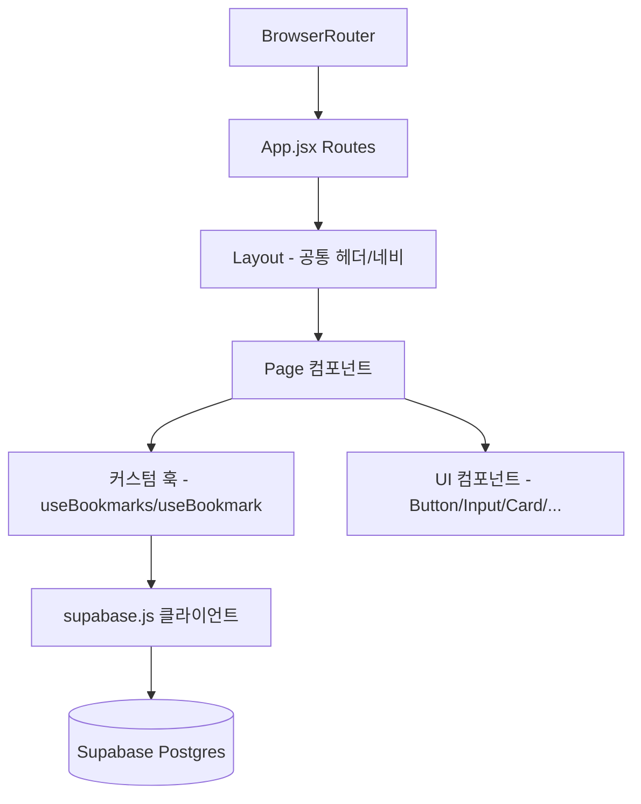
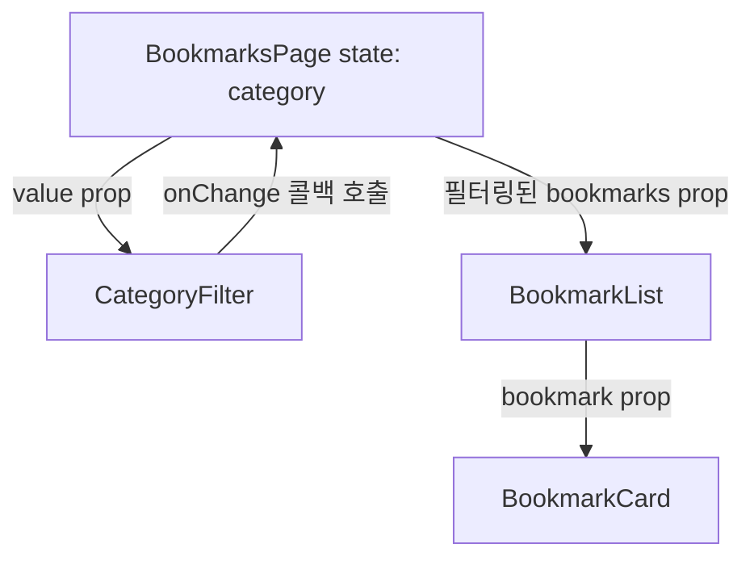
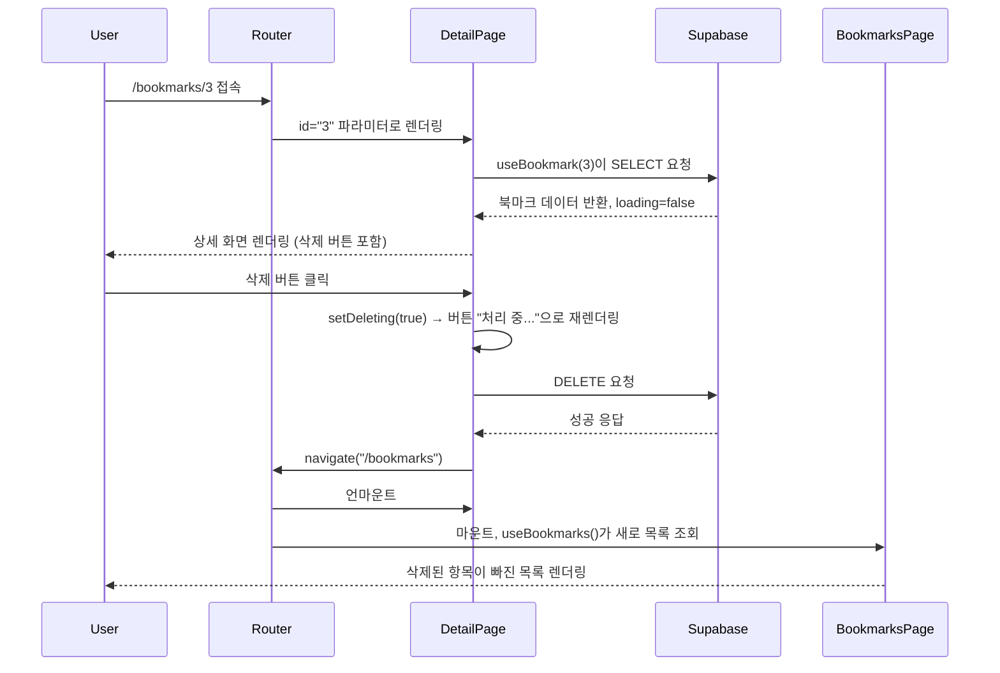

# Bookmark Keeper 구조 분석 문서

## 프로젝트 개요

React Router 기반 SPA + Supabase 백엔드로 만든 개인용 북마크 관리 앱이다.
평가 포인트가 "백엔드"가 아니라 "React의 상태/렌더링 구조"라고 명시되어 있어서,
북마크 CRUD 자체는 최대한 단순하게 잡고 컴포넌트 분리와 데이터 흐름 쪽에 힘을 줬다.



인간은 결국 "누르면 뭔가 바뀌는 것"을 좋아해서 프론트엔드를 만들었다. 문명이 망해도 버튼은 계속 눌릴 것이다.

---

# 전체 아키텍처



---

# 디렉토리 구조

```txt
src/
├── pages/        # 라우트 단위 화면 6개
├── components/   # 재사용 UI 컴포넌트 10개
├── hooks/        # useBookmarks, useBookmark
├── lib/          # supabase.js, constants.js
├── App.jsx       # 라우트 정의
└── main.jsx      # BrowserRouter 진입점
```

---

# 과제 목표 답변

## 1. 컴포넌트가 왜 필요한가, 어떤 기준으로 쪼갰는가

컴포넌트를 안 나누면 `BookmarksPage.jsx` 하나에 필터 UI, 카드 목록, 로딩/에러/빈 상태 처리가
전부 섞여서 300줄짜리 파일이 된다. 그리고 상세 페이지에서도 로딩/에러 UI를 또 만들어야 한다 — 복붙의 지옥.

내가 쓴 분리 기준은 두 가지다.

1. **"페이지" vs "UI 부품"**: 페이지(`pages/`)는 라우트 하나 = 화면 하나를 책임지고,
   화면을 이루는 조각(`components/`)은 여러 페이지에서 재사용 가능해야 한다.
2. **prop으로 동작/표시가 달라지는가**: `Button`은 `variant`/`loading` prop에 따라 색과 텍스트가 바뀌고,
   `Loading`/`ErrorState`/`EmptyState`는 `message` prop 하나로 어떤 화면에서든 재사용된다.
   `BookmarksPage`와 `BookmarkDetailPage`가 각자 로딩 UI를 새로 만들지 않고 `<Loading message="..."/>`
   하나로 통일한 게 이 기준을 그대로 적용한 예시다.

`BookmarkForm`은 등록/수정 화면 둘 다에서 쓰인다. `initialValues`와 `onSubmit`만 다르게 주입하면
검증 로직·컨트롤드 인풋·제출 상태 처리를 두 번 안 짜도 된다 — 컴포넌트를 나누는 진짜 이유는
"재사용"보다 "같은 버그를 두 번 만들 확률을 줄이는 것"에 가깝다.

## 2. props와 state의 차이, 상태를 어디에 뒀는가

- **state**: 그 컴포넌트가 "직접 소유하고 바꾸는" 데이터. 예: `BookmarksPage`의 `category` (내가 고른 필터값),
  `BookmarkForm`의 `values`/`errors`/`submitting` (내가 입력하고 있는 폼 데이터).
- **props**: 부모가 "위에서 내려준" 읽기 전용 데이터 + 콜백. 예: `BookmarkCard`는 `bookmark` 객체를 prop으로
  받아서 표시만 한다. 데이터를 직접 fetch하지 않는다 — fetch는 `BookmarksPage`가 `useBookmarks()`로 한 번만 하고,
  그 결과를 `BookmarkList` → `BookmarkCard`로 아래로 흘려보낸다(하향 흐름).

상향 흐름의 예: `CategoryFilter`는 자기 state가 없다. `value`/`onChange`를 `BookmarksPage`에서 받아서
`<select>`가 바뀌면 `onChange(e.target.value)`를 호출해 부모의 `setCategory`를 실행시킨다.
즉 "이 필터의 현재 값이 뭔지"는 자식이 아니라 부모(`BookmarksPage`)가 알고 있다 — 이게 controlled component 패턴이고,
자식은 표시만, 상태 소유는 부모가 하는 구조다.



상태를 "가능한 한 필요한 곳에서 가장 가까운 공통 조상"에 두는 원칙을 따랐다. 폼 입력값은 `BookmarkForm`
내부에만 있고 페이지는 모른다 — 페이지가 알 필요가 없기 때문이다. 반면 목록 데이터는 `BookmarksPage`가
가지고 있어야 `BookmarkList`와 `CategoryFilter` 둘 다에서 접근 가능하다.

## 3. useEffect는 언제 실행되고, 어떤 의존성으로 동작하며, 데이터 요청과 어떤 관계인가

`useBookmarks.js`:

```js
useEffect(() => {
  refetch();
}, [refetch]);
```

`refetch`는 `useCallback(..., [])`로 감싸져 있어서 컴포넌트가 리렌더링돼도 참조가 바뀌지 않는다.
즉 이 `useEffect`는 **컴포넌트가 처음 마운트될 때 딱 한 번** 실행된다. React가 렌더링을 다 마친 뒤(commit 이후)
실행되므로, "렌더링 도중에 fetch를 부르면 안 된다"는 규칙을 자연스럽게 지킨다.

`useBookmark.js`는 의존성 배열이 `[refetch]`이고 `refetch`는 `id`에 의존한다:

```js
const refetch = useCallback(async () => { ... }, [id]);
useEffect(() => { refetch(); }, [refetch]);
```

`/bookmarks/1`에서 `/bookmarks/2`로 이동하면 React Router가 같은 `BookmarkDetailPage` 컴포넌트를
언마운트하지 않고 재사용하면서 `id` 파라미터만 바뀐다. `id`가 바뀌면 `refetch` 함수 자체가 새로 만들어지고,
그 결과 `useEffect`의 의존성이 바뀐 것으로 감지되어 **다시 실행**된다 — 이게 "라우트 파라미터 변경 → 새 데이터 요청"이
자동으로 연결되는 지점이다. `id`를 의존성에서 빼먹으면 URL만 바뀌고 화면은 이전 데이터를 계속 보여주는
전형적인 버그가 난다(직접 겪음, 처음엔 의존성 배열을 `[]`로 뒀다가 상세 페이지를 못 옮겨다녔다).

## 4. 비동기 흐름에서 로딩/성공/실패/빈 상태를 어떻게 표현했는가

모든 목록/상세 화면이 같은 3단 분기를 쓴다 (`BookmarksPage.jsx` 예시):

```jsx
{loading && <Loading message="..." />}
{!loading && error && <ErrorState message="..." onRetry={refetch} />}
{!loading && !error && <BookmarkList bookmarks={filtered} />}
```

- **로딩**: 훅의 `loading` state가 `true`인 동안 `Loading` 컴포넌트(스피너)를 보여준다.
- **에러**: `error` state에 메시지가 들어있으면 `ErrorState`가 뜨고, "다시 시도" 버튼이 `refetch`를 다시 호출한다
  (요구사항 예시 문구 "요청에 실패했습니다. 다시 시도하세요."를 그대로 썼다).
- **빈 상태**: 요청은 성공했지만 배열 길이가 0이면 `BookmarkList` 내부에서 `EmptyState`("표시할 데이터가 없습니다.")로 분기한다.
  즉 "빈 배열"은 에러가 아니라 정상적인 성공 케이스의 한 갈래로 다룬다 — 이 구분을 안 하면 데이터가 없을 때마다
  가짜 에러 화면이 뜨는 실수를 하게 된다.
- **제출 중**: `BookmarkForm`의 `submitting` state가 `Button`의 `loading` prop으로 내려가서 버튼이 비활성화되고
  "처리 중..."으로 바뀐다. 삭제도 `BookmarkDetailPage`의 `deleting` state로 동일한 패턴을 쓴다.

## 5. "하나의 기능"에서 라우팅 → 컴포넌트 → 상태 → 이벤트 → 렌더링이 어떻게 연결되는가

"북마크 삭제" 기능 하나로 전체 흐름을 추적하면:



1. **라우팅**: `/bookmarks/:id` 경로가 `BookmarkDetailPage`를 렌더링하며 `id`를 넘긴다.
2. **컴포넌트**: `BookmarkDetailPage`가 `useBookmark(id)` 훅으로 데이터를 가져오고, `Button`(삭제) 컴포넌트를 렌더링한다.
3. **상태**: 클릭 이벤트가 `deleting` state를 `true`로 바꾸고, Supabase 응답에 따라 `deleteError` state가 채워지거나
   `navigate()`가 호출된다.
4. **이벤트**: `onClick={handleDelete}`가 비동기 함수를 트리거하고, 그 함수 내부의 state 변경이 리렌더링을 유발한다.
5. **렌더링**: 삭제 성공 시 라우트 자체가 바뀌면서(`navigate("/bookmarks")`) React Router가 `BookmarksPage`를 새로
   마운트하고, 그 안의 `useBookmarks()`가 다시 최신 목록을 가져와 렌더링한다 — 별도의 "리스트에서 항목 제거" 로직을
   따로 안 짜도, 라우트 이동 + 재조회 조합만으로 목록이 자동으로 최신 상태가 된다.

---

# 설계 판단 메모

- **전역 상태 미도입**: 보너스 과제라 스킵했다. 페이지 간 공유해야 하는 상태가 없어서(각 페이지가 자기 데이터만 필요) Context를
  넣었으면 오히려 안 써도 되는 레이어가 하나 더 생겼을 것이다.
- **카테고리 필터를 클라이언트 사이드로 처리**: 데이터 규모가 작은 개인용 앱이라 매번 Supabase에 재요청하는 대신
  `useMemo`로 이미 가져온 배열을 필터링한다 — 서버 왕복 없이 즉시 렌더링되는 상태 변경 흐름의 예시로도 좋다.
- **RLS**: 이번 미션은 인증이 요구사항이 아니라서, `anon` role에 전체 CRUD를 허용하는 permissive 정책 하나만 걸었다
  (`schema.sql` 참고). 실서비스였다면 `auth.uid()` 기반으로 row별 소유자 제한을 걸어야 한다.
